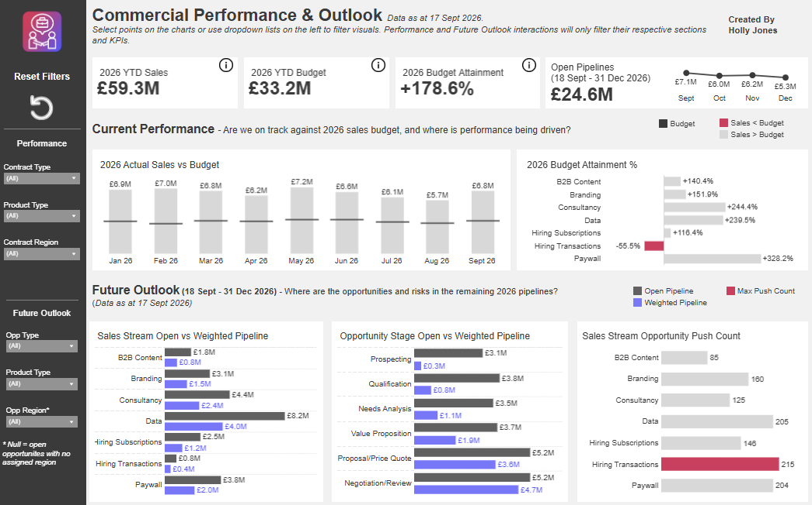
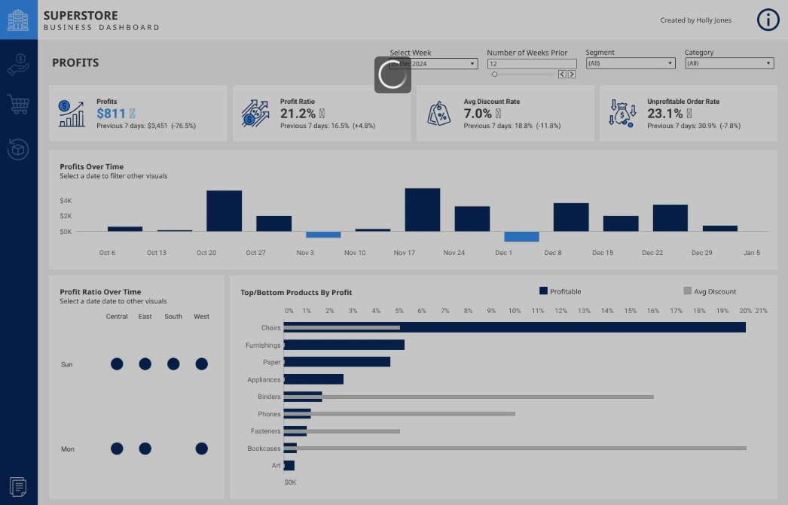
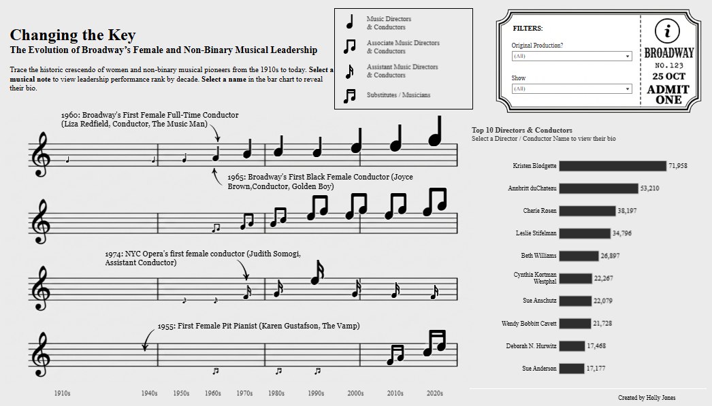
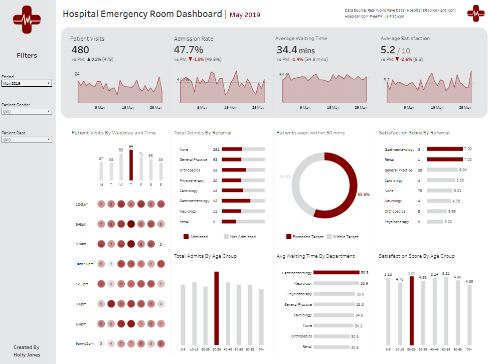

A collection of personally created Tableau dashboards demonstrating business intelligence, data storytelling, dashboard design, and analytical problem solving. Projects range from executive reporting solutions to community visualisation challenges.

## ⭐ Featured Project

  

  <h3>Commercial Performance & Outlook Dashboard</h3>

  

  

    <strong>Project Overview</strong> 
    Interactive Tableau dashboard developed as part of a BI Developer technical assessment, combining sales performance, budget attainment, and pipeline forecasting into a single executive reporting solution.
  

  

    <strong>Business Challenge</strong> 
    Provide senior commercial stakeholders with a clear view of current performance against budget and assess where future pipeline opportunities and risks lie.
  

  

    <strong>Key Metrics</strong> 
    YTD Sales, YTD Budget, Budget Attainment %, Open Pipeline Value, Weighted Pipeline, Sales vs Budget Variance, and Opportunity Push Count.
  

  

    <strong>Tools & Techniques</strong> 
    ableau, Dashboard Design, Calculated Fields, Interactive Filters, KPI Reporting, Variance Analysis, Pipeline Analytics, and Data Storytelling.
  

  

    <a href="" target="_blank">
      View Interactive Dashboard →
    </a>
  

  

  

  

    
  

## 📊 Business Dashboards

Dashboards designed to support business decision-making through interactive reporting and performance monitoring.

## 🏆 Viz of the Day
A collection of Tableau community challenge submissions focused on creativity, storytelling, and advanced visualisation techniques.

  

  <h3>Superstore Business Performance Dashboard</h3>

  

  

    <strong>Project Overview</strong> 
    Interactive business intelligence solution developed using the Tableau Superstore dataset, providing a comprehensive view of sales, profitability, and returns performance across products, regions, and customer segments.
  

  

    <strong>Business Challenge</strong> 
    Provide decision-makers with a unified view of commercial performance by identifying sales trends, profitability drivers, and return-related risks to support data-driven business decisions.
  

  

    <strong>Key Metrics</strong> 
    Sales Revenue, Profit, Profit Ratio, Discount Rate, Unprofitable Order Rate, Return Rate, Financial Loss from Returns, Average Days to Ship, Product Performance, and Regional Sales Trends.
  

  

    <strong>Tools & Techniques</strong> 
    KPI Reporting, Calculated Fields, Interactive Filters, Geographic Mapping, Profitability Analysis, Returns Analysis, Dashboard Navigation, Performance Monitoring, and Data Visualisation.
  

  

    <a href="" target="_blank">
      View Interactive Dashboard →
    </a>
  

  

  

  

    
  

---

  

  <h3>Changing the Key: The Evolution of Broadway's Female and Non-Binary Musical Leadership</h3>

  

  

    <strong>Project Overview</strong> 
    Visual storytelling project created for the Makeover Monday community initiative, exploring the growth and representation of women and non-binary conductors in Broadway productions from the 1910s to the present day.
  

  

    <strong>Business Challenge</strong> 
    Transform a static dataset into an engaging narrative that highlights key milestones, representation trends, and influential figures while making historical insights accessible to a wider audience.
  

  

    <strong>Key Metrics</strong> 
    Number of Productions, Director & Conductor Credits, Representation by Decade, Top Conductors by Production Count, and Historical Milestones.
  

  

    <strong>Tools & Techniques</strong> 
    Data Storytelling, Custom Visual Design, Interactive Filtering, Historical Timeline Visualisation, Annotation Techniques, and Dashboard Design.
  

  

    <a href="" target="_blank">
      View Interactive Dashboard →
    </a>
  

  

  

  

    
  

---

  

  <h3>Emergency Department Operations Dashboard</h3>

  

  

    <strong>Project Overview</strong> 
    Emergency Department performance dashboard developed using the Real World Fake Data Hospital Emergency Room dataset to monitor patient activity, operational efficiency, and patient experience.
  

  

    <strong>Business Challenge</strong> 
    Analyse patient demand patterns and operational performance to understand factors affecting waiting times, admissions, and patient satisfaction.
  

  

    <strong>Key Metrics</strong> 
    Patient Visits, Admission Rate, Average Waiting Time, Satisfaction Score, Patients Seen Within Target, Referral Source Performance, and Demographic Trends.
  

  

    <strong>Tools & Techniques</strong> 
    Tableau, Dashboard Actions, Interactive Filters, Calculated Fields, Healthcare KPI Reporting, Variance Analysis, and Data Visualisation.
  

  

    <a href="" target="_blank">
      View Interactive Dashboard →
    </a>
  

  

  

  

    
  

## 🌱 Environment & Sustainability
Projects focused on environmental, climate, and sustainability-related topics.

## 🔄 Makeover Monday
Visualisation redesigns created as part of the Makeover Monday community initiative.

## 📖 Data Storytelling
Visualisations designed to communicate insights through clear narratives, helping transform complex data into meaningful and actionable stories.

My complete collection of Tableau visualisations can be viewed on Tableau Public.
